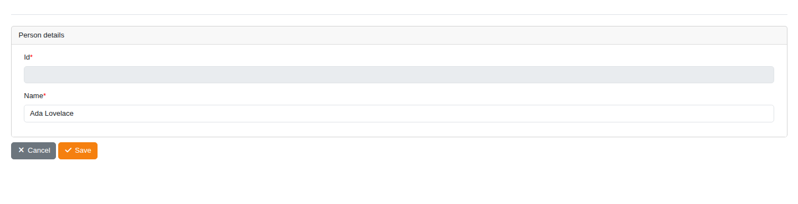

<!-- Hallmark · Ecosystem Index · existing graphite and copper design system -->

<section class="docs-landing__hero" aria-labelledby="docs-home-title">

<h1 id="docs-home-title">Data Dictionary driven CRUDs.</h1>

JJMasterData generates forms and grids from metadata in your ASP.NET Core app. Define fields, validation rules, and actions in a data dictionary, then customize the behavior as your application grows.

<a class="docs-home__action docs-home__action--primary" href="articles/getting-started/configuration.md">Get started →</a>
<a class="docs-home__action" href="articles/concepts/architecture.md">How it works</a>

<code>dotnet add package JJMasterData.Web</code>

<section class="docs-landing__start" aria-labelledby="first-crud-title">
<h2 id="first-crud-title">Build your first CRUD</h2>

Follow the walkthrough from an ASP.NET Core host to a saved record.

<ol class="docs-landing__steps">
<li><a href="articles/getting-started/configuration.md">Configure your app →</a>
Install the package, connect a database, and register the routes.
</li>
<li><a href="articles/getting-started/first-dictionary.md">Create a dictionary →</a>
Define a Person entity, its fields, and a form panel.
</li>
<li><a href="articles/getting-started/first-dictionary.md#5-insert-the-first-record">Save your first record →</a>
Open the generated CRUD and persist a record.
</li>
</ol>
</section>
</section>

<section class="docs-landing__example" aria-labelledby="example-title">

<h2 id="example-title">Metadata becomes an interface.</h2>

The tutorial's Person dictionary produces this form: an identity field, a required name, and the actions to save a record.

<a href="articles/getting-started/first-dictionary.md">Follow the tutorial →</a>

<figure>

<figcaption>The generated form from the first-dictionary walkthrough.</figcaption>
</figure>
</section>

<nav class="docs-landing__explore" aria-labelledby="explore-title">
<h2 id="explore-title">Explore the documentation</h2>

<section class="docs-landing__topic">
<h3>Understand the model</h3>

Learn how metadata defines the interface and its behavior at runtime.

<ul>
<li><a href="articles/concepts/data-dictionary.md">Data dictionaries</a></li>
<li><a href="articles/concepts/components.md">Fields and components</a></li>
<li><a href="articles/concepts/expressions.md">Expressions</a></li>
<li><a href="articles/concepts/rules.md">Validation rules</a></li>
</ul>
</section>
<section class="docs-landing__topic">
<h3>Work with records</h3>

Use generated CRUDs and control how data is read, written, and stored.

<ul>
<li><a href="articles/concepts/crud-operations.md">CRUD operations</a></li>
<li><a href="articles/concepts/actions.md">Actions</a></li>
<li><a href="articles/developer-guide/repositories/index.md">Connections and repositories</a></li>
<li><a href="articles/concepts/persistence.md">Dictionary persistence</a></li>
</ul>
</section>
<section class="docs-landing__topic">
<h3>Make it fit your app</h3>

Embed the UI, apply access policies, and extend forms and grids.

<ul>
<li><a href="articles/developer-guide/customizations/routes-and-embedding.md">Routes and embedding</a></li>
<li><a href="articles/developer-guide/authorization.md">Authorization</a></li>
<li><a href="articles/developer-guide/customizations/ui-customization.md">UI customization</a></li>
<li><a href="articles/developer-guide/templates/index.md">Templates</a></li>
</ul>
</section>
<section class="docs-landing__topic">
<h3>Solve a specific task</h3>

Apply worked recipes to common application requirements.

<ul>
<li><a href="articles/cookbook/editable-grid.md">Edit values in a grid</a></li>
<li><a href="articles/cookbook/business-validation.md">Validate business operations</a></li>
<li><a href="articles/cookbook/task-form.md">Create a task form</a></li>
<li><a href="articles/cookbook/index.md">All recipes →</a></li>
</ul>
</section>

</nav>

<nav class="docs-landing__reference" aria-label="Reference and troubleshooting">

Looking up a detail?

<ul>
<li><a href="api/JJMasterData.Commons.yml">API reference</a></li>
<li><a href="articles/developer-guide/configuration.md#configuration-reference">Configuration</a></li>
<li><a href="articles/developer-guide/webapi.md">Web API</a></li>
<li><a href="articles/developer-guide/templates-troubleshooting.md">Troubleshooting</a></li>
</ul>
</nav>

